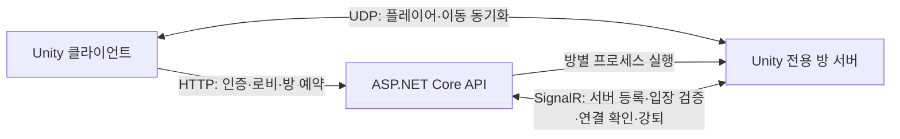

# Smart Training Server

ASP.NET Core Web API와 Unity 전용 서버를 연결한 멀티플레이 기반 훈련 플랫폼의 백엔드입니다. 사용자·로비·방·입장 권한을 관리하고, 실제 플레이어 연결과 움직임은 Unity Netcode 전용 서버가 처리합니다.

현재는 **멀티 접속과 방 관리 기반을 구현하는 단계**입니다. 훈련 장치 상호작용, 훈련 시나리오, 결과 기록은 앞으로 개발할 콘텐츠이며 현재 구현 기능에 포함하지 않습니다.

- 연동 프로젝트: [Smart Training Platform](https://github.com/Jaehyung2028/Smart-Training-Platform)
- 개발 범위: 사용자 세션, 로비·방 관리, 접속 예약, 전용 서버 프로세스 연동, 방장 권한과 연결 종료 처리
- 기준 환경: Windows, ASP.NET Core / .NET 8, Unity 6000.4.7f1

## 설계 의도

방에 참가하겠다는 요청과 실제 네트워크 접속은 서로 다른 시점에 일어납니다. HTTP 응답만으로 참가자를 확정하면 접속 실패나 중복 요청으로 방 인원이 실제 연결 상태와 달라질 수 있습니다. 이를 줄이기 위해 **예약 → 검증 → 연결 확정**으로 상태를 나누었습니다.



실시간 플레이 상태를 Web API로 보내지 않고 Unity Netcode에서 동기화합니다. 방장도 클라이언트의 역할일 뿐, 네트워크 호스트는 전용 서버입니다. 따라서 방장 변경 시 다른 참가자가 서버를 다시 열 필요가 없습니다.

## 현재 구현 기능

| 영역 | 구현 내용 | 주요 코드 |
|---|---|---|
| 인증 | 닉네임 로그인, 불투명 Bearer 토큰, 갱신·만료·로그아웃 처리 | `Services/Auth/UserService.Session.cs`, `UserTokenAuthenticationHandler.cs` |
| 로비·방 | catalog.json 기반 로비 목록, 로비 입장·퇴장, 로비 안의 방 생성·조회·정원 관리 | `Services/Lobby`, `Services/Room/RoomService.cs` |
| 입장 예약 | 예약 토큰·만료 관리, 동시 예약 정원 확인, 실제 연결 시 참가 확정 | `RoomService.Admission.cs`, `Hubs/RoomHub.cs` |
| 전용 서버 | 방별 프로세스 실행, 등록 대기, 실행 실패·종료 감시 및 상태 정리 | `Helper/ProcessHelper.cs`, `RoomService.ServerLifecycle.cs` |
| 방장 | 표시용 정보 제공, 퇴장 시 자동 위임, 연결된 참가자에게 수동 위임 | `RoomService.Master.cs` |
| 강퇴 | 방장 권한 확인 후 현재 입장 토큰에 해당하는 연결 종료 요청 | `RoomService.Master.cs` |
| 입장 잠금 | 신규 입장 차단, 미확정 예약 취소, 기존 연결 유지 | `RoomService.Settings.cs` |
| 오류 응답 | 입력 검증, 인증 실패, 공개 조회 DTO와 내부 상태 분리 | `Services/Api`, `Responses` |

닉네임 기반 세션 인증입니다. 계정 비밀번호 로그인이나 JWT 인증으로 설명하지 않습니다. 현재 사용자·로비·방 상태는 메모리에 저장되며 서버 재시작 시 유지되지 않습니다.

## 추가 구현 기능

- 점검·종료 예약·운영 재개를 단일 운영 모드 API로 관리하며 변경 사유와 설정 버전을 함께 확인합니다.

- 카탈로그 콘텐츠별 고정 로비와 ASP.NET의 즉시 입장·퇴장 처리
- 방 생성 시 카탈로그의 루트·하위 콘텐츠 선택 및 해당 트리 안의 노드 ID 검증
- 방 이름·정원 변경, 비밀번호 설정·변경·해제, 방 닫기
- 전원 준비 확인에 따른 시작·대기 복귀와 진행 중 입장·설정 제한
- 로비·방 채팅, 참가자 조회, 방·인원·운영 상태의 실시간 알림
- 로비·방별 SignalR 그룹 전송과 재입장 시 이전 방 채팅 메시지 제외
- 로컬 운영 페이지, 점검과 종료 예정 전환, 상태 조회 및 운영 이력 기록
- 동시 요청·입장 취소·프로세스 종료가 겹치는 상황의 상태 정리와 검증

콘텐츠 카탈로그에는 예시 세 개가 있으며 실제 훈련 콘텐츠 구현을 뜻하지 않습니다. 로비 목록이 있다는 이유만으로 Unity 서버를 모두 실행하지 않고, 방 입장 요청과 참가·예약 상태에 따라 Unity 방 서버의 실행 수명을 관리합니다.

## 접속 흐름

1. 클라이언트가 로그인하고 Bearer 토큰을 받습니다.
2. 카탈로그 로비 입장은 ASP.NET이 직접 처리하며 Unity 로비 프로세스를 실행하지 않습니다. 방 생성 시 생성자의 입장 자리를 함께 예약합니다. Unity는 곧바로 `POST /api/Room/join`을 호출해 그 예약으로 자동 접속하고, 기존 방 참가자는 같은 API로 새 자리를 예약합니다.
3. 필요한 경우 API가 전용 방 서버를 실행하고 등록을 기다립니다.
4. 클라이언트가 예약 토큰으로 Unity 전용 서버에 접속합니다.
5. 전용 서버가 `RoomHub.ValidateConnection`으로 예약을 검증하고 `ConfirmConnection`으로 참가를 확정합니다.
6. 연결 종료 시 `ClientDisconnected`와 API 퇴장 처리를 통해 참가자·예약 정보를 정리합니다.

방장 위임·강퇴·잠금 요청은 요청 본문의 사용자 ID를 신뢰하지 않고 인증된 사용자와 실제 방 참가 상태로 권한을 확인합니다.

## 해결한 문제

| 문제 | 원인과 처리 |
|---|---|
| Unity 에디터 종료 후 닉네임이 사용 중으로 남음 | 정상 로그아웃 없이 Play가 종료되는 경로를 고려해 클라이언트 종료 정리와 서버 세션 만료 정리를 함께 적용 |
| 입장 예약만으로 실제 참가자가 표시됨 | 예약 인원과 연결 인원을 분리하고 전용 서버의 연결 확인 후 참가 확정 |
| 전용 서버가 HTTPS 리디렉션으로 등록에 실패 | 개발 실행을 `ListenAnyIP(Server:Port)`의 HTTP 단일 포트로 정리하고 클라이언트·전용 서버의 API 주소를 통일 |
| 방장 퇴장으로 관리 권한이 사라짐 | 실제 연결된 참가자의 방 인덱스를 기준으로 자동 위임하고 Unity 플레이어에 동기화 |
| 강퇴 요청 후 인원을 미리 제거할 위험 | 현재 연결 토큰으로 종료 요청을 전달하고 실제 연결 종료 후 참가 상태 정리 |
| 연결 끊김 후 재접속 시 중복 상태 발생 가능 | 이전 접속 정리 확인 후 새 예약으로 재입장. 기존 예약 토큰을 재사용하지 않음 |

## 실행 방법

Windows에 .NET 8 런타임과 .NET SDK를 설치합니다. 솔루션 파일(`.slnx`)을 IDE로 열려면 이를 지원하는 IDE가 필요하며, 아래 명령은 프로젝트 파일을 직접 사용합니다.

### 1. Unity 전용 서버 준비

[플랫폼 저장소](https://github.com/Jaehyung2028/Smart-Training-Platform)의 Unity 프로젝트를 열고 Windows Dedicated Server 모듈을 설치합니다. 메뉴 `Smart Training > Build > Build Windows Test Bundle`로 클라이언트와 전용 서버를 함께 빌드하거나, 기존 `Smart Training > Build Windows Room Server` 메뉴를 사용합니다.

통합 빌드의 `Builds/TestBundles/날짜-고유번호/RoomServer` 또는 개별 빌드의 `Builds/RoomServer` 폴더의 **전체 내용**을 이 저장소의 `Smart Training Server/RoomServer`에 복사합니다. 실행 파일 하나만 복사하면 실행되지 않습니다. 실행 파일 이름은 `Smart Training Room.exe`입니다.

Unity 빌드 파일은 Git에서 제외합니다. 저장소를 처음 내려받은 경우 위 과정이 필요합니다. API만 실행하는 것은 가능하지만 전용 서버가 없으면 실제 방 접속은 실패합니다.

별도 로비 실행 파일은 필요하지 않습니다. 새 방 서버 실행 파일을 별도 위치에서 사용할 때는 Room:ServerExecutablePath를 지정합니다.

### 2. API 실행

저장소 루트에서 실행합니다.

```powershell
dotnet run --project "Smart Training Server/Smart Training Server.csproj" --launch-profile http
```

- Swagger: `http://localhost:5229/swagger/index.html`
- HTTP 개발 주소: `http://localhost:5229`
- 상태 확인: `GET /api/health`
- 기본 전용 서버 API 주소: `http://127.0.0.1:5229`

다른 주소를 사용하면 `appsettings.json`의 `Room:ServerApiBaseUrl`과 Unity 클라이언트 주소를 함께 변경합니다. 다른 PC에서 접속하려면 `Room:AdvertisedAddress` 및 방 서버 UDP 포트 접근도 설정해야 합니다. 현재 검증 범위는 Windows 로컬 개발 환경입니다.

### 주요 API

| 요청 | 기능 |
|---|---|
| `POST /api/Auth/login`, `/refresh`, `/logout` | 로그인·갱신·로그아웃 |
| `GET /api/Auth/me` | 현재 사용자 상태 |
| `GET /api/Lobby` | 로비 목록 |
| `POST /api/Lobby/join`, `/leave` | 카탈로그 로비 입장·퇴장 |
| `GET /api/Lobby/{lobbyId}/contents` | 콘텐츠 메타데이터 |
| `GET /api/Lobby/{lobbyId}/rooms` | 방 목록 |
| `POST /api/Room/create`, `/join`, `/leave` | 방 생성·예약·퇴장 |
| `POST /api/Room/transfer-master`, `/kick`, `/entry-lock` | 방장 관리 |

요청·응답 형식은 실행 후 Swagger에서 확인할 수 있습니다.


## 앞으로 개발할 부분

- 훈련 콘텐츠와 시나리오, 장치 상호작용
- 사용자 계정 및 훈련 결과의 영속 저장
- 외부 네트워크 배포 환경 검증과 운영 설정
- 실제 사용자 화면 및 데모 영상 보강

현재 단계에서는 위 기능을 구현 완료로 표시하지 않습니다.

## 변경 기록과 업로드 방식

첫 업로드는 현재 멀티 접속 기반을 하나의 커밋으로 정리합니다. 이후에는 업로드 요청 시 변경 파일, 실제 구현 범위, 실행 방법을 확인하고 README를 갱신한 뒤 커밋·푸시합니다. 개발 중 변경을 자동으로 공개하지 않습니다.

## 교육과정 샘플

`Contents/catalog.json`은 장비 기초·작업 안전·비상 대응의 3개 교육과정과 12개 실행 콘텐츠를 정의합니다. 과정별로 모델·영상·실습·협동 실습을 포함하며 분류 단계의 깊이를 다르게 구성했습니다. 모든 최하위 노드에 Unity 샘플 프리팹의 `assetId`를 지정했습니다. 분류 노드는 방 콘텐츠로 선택할 수 없습니다.
