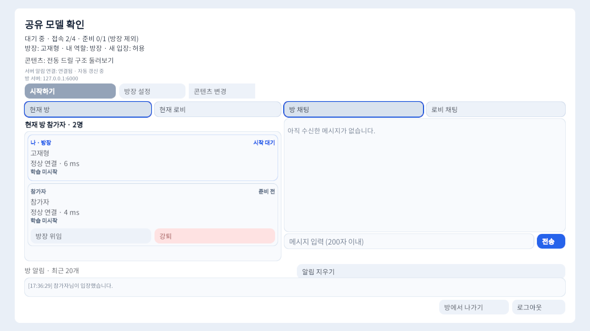
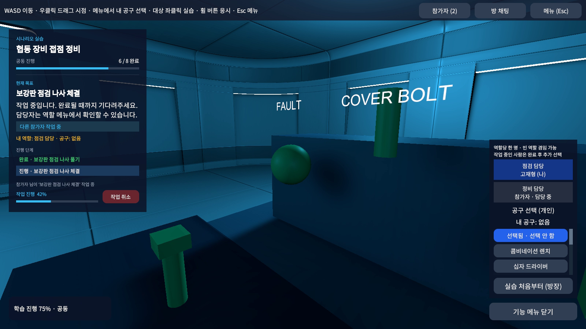
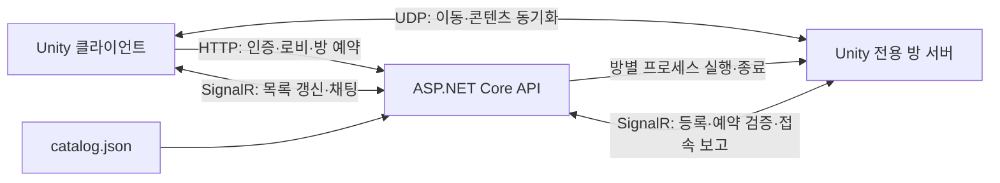

# Smart Training Server

Unity 멀티플레이 교육 플랫폼의 **ASP.NET Core 8 백엔드**입니다. 사용자 세션, 교육과정 로비, 방 권한과 입장 예약을 관리하고, 필요할 때 Unity 전용 방 서버를 실행합니다. 플레이어 이동과 콘텐츠 동작은 Unity Netcode 서버가 담당합니다.

- 작성자: 고재형
- [Unity 플랫폼 저장소](https://github.com/Jaehyung2028/Smart-Training-Platform)
- [1분 시연 영상](https://github.com/Jaehyung2028/Smart-Training-Platform/blob/main/docs/media/demo-60s.mp4)
- 기준 환경: Windows / .NET 8 / Unity 6000.4.7f1

## 연동 화면

아래는 이 백엔드와 연결한 Unity 클라이언트의 실제 화면입니다.





## 책임 분리



로비는 카탈로그 기반 데이터이므로 별도의 Unity 로비 프로세스를 실행하지 않습니다. 방은 접속 요청에 따라 전용 서버가 시작되고, 인원이 없으면 정리됩니다. 여러 방은 서로 다른 포트의 프로세스로 실행됩니다. 방장은 사용자 권한이며 서버 프로세스의 소유자를 의미하지 않습니다.

## 구현 기능

| 영역 | 내용 |
|---|---|
| 사용자 세션 | 닉네임 로그인, Bearer 토큰 인증, 세션 갱신·종료·만료 정리 |
| 교육과정 | 로그인 전 목록 조회, catalog.json의 콘텐츠 트리, 최하위 실행 노드 선택 |
| 로비 | 과정별 사용자·방 목록, 참가자 조회, 실시간 변경 알림 |
| 방 관리 | 생성자 자동 입장, 준비·시작·대기 복귀, 이름·정원·비밀번호·콘텐츠 변경 |
| 방장 권한 | 자동/수동 위임, 강퇴, 입장 잠금, 권한·소속 검사 |
| 접속 예약 | 예약·취소·만료, 정원 검사, 전용 서버 승인과 연결 확정 분리 |
| 프로세스 | 온디맨드 실행, 준비 대기, 서버 등록 토큰, 종료 감시·포트 반환, API 종료 시 자식 프로세스 정리 |
| 실시간 통신 | SignalR 그룹 기반 로비·방 채팅, 구독·연결 종료 정리 |
| 운영 웹 | 운영 상태·이력 조회, 점검/종료 예약을 통합한 운영 모드 변경, 사유·버전 검사 |
| HTTP 처리 | 입력 검증, 공통 오류 응답과 추적 ID, 설정 바인딩·시작 시 검사 |

### 예약부터 접속까지

1. 인증된 사용자가 방 생성 또는 참가를 요청합니다.
2. API가 소속·정원·비밀번호·운영 상태를 확인하고 자리를 예약합니다.
3. 전용 서버가 없으면 프로세스를 시작하고 준비 완료를 기다립니다.
4. 클라이언트는 안내받은 IP·UDP 포트와 입장 토큰으로 Netcode 접속을 요청합니다.
5. Unity 서버가 API에 예약 유효성을 확인하고, 실제 연결 완료를 보고합니다.
6. 예약 인원을 접속 인원으로 전환합니다. 취소·실패·만료·종료 시 관련 상태를 정리합니다.

HTTP 참가 성공과 실제 UDP 연결 완료를 구분해 연결 실패가 방 인원이나 다음 입장을 막지 않도록 구성했습니다. 일반 사용자 요청의 본인 ID는 클라이언트 입력 대신 인증 결과에서 얻습니다.

### 인증과 상태 수명

사용자 토큰은 서버 메모리의 세션과 대조하는 불투명 Bearer 토큰입니다. JWT나 비밀번호 기반 계정 시스템은 아닙니다. Unity 서버 등록 토큰과 플레이어 입장 토큰은 용도가 다릅니다.

사용자·로비 참가·방 상태는 메모리에 보관합니다. API 재시작 후 재로그인이 필요하며, 훈련 결과를 영구 저장하는 DB는 없습니다. 운영 이력은 옵션에 따라 파일에 보관할 수 있습니다.

## 교육과정과 Unity 콘텐츠

[카탈로그](Smart%20Training%20Server/Contents/catalog.json)는 **장비 기초·작업 안전·비상 대응 3개 교육과정, 12개 실행 콘텐츠**를 정의합니다. 각 과정에는 모델 1개·영상 1개·실습 1개·협동 실습 1개가 있습니다.

| 필드 | 역할 |
|---|---|
| `rootContent` | 교육과정 식별자 |
| `id`, `title`, `children` | 노드 ID·표시명·하위 트리 |
| `contentType` | category / model / video / scenario |
| `assetId` | Unity Addressables 콘텐츠 프리팹 주소 |

분류 노드는 방 콘텐츠로 선택할 수 없습니다. 실제 모델 관찰·영상 동기화·공구와 협동 시나리오는 Unity 저장소에 구현되어 있습니다. 현재 자료는 플랫폼 동작을 보여주는 샘플입니다.

## 주요 코드

| 위치 | 역할 |
|---|---|
| [Program.cs](Smart%20Training%20Server/Program.cs) | 서비스 등록·인증·HTTP 처리·Hub 연결 |
| [_Controllers](Smart%20Training%20Server/_Controllers) | HTTP 요청을 서비스로 전달하고 응답 반환 |
| [Services/Auth](Smart%20Training%20Server/Services/Auth) | 세션과 토큰 인증 |
| [Services/Lobby](Smart%20Training%20Server/Services/Lobby) | 교육과정 로비와 콘텐츠 조회 |
| [Services/Room](Smart%20Training%20Server/Services/Room) | 방·예약·권한·전용 서버 상태 |
| [Hubs](Smart%20Training%20Server/Hubs) | 사용자 이벤트·채팅과 Unity 서버 관리 통신 |
| [Helper](Smart%20Training%20Server/Helper) | 프로세스·포트·네트워크 주소 처리 |
| [Services/Operations](Smart%20Training%20Server/Services/Operations) | 운영 모드·운영 이력 |
| [Options](Smart%20Training%20Server/Options) | 설정 객체와 시작 시 유효성 검사 |
| [Requests](Smart%20Training%20Server/Requests) / [Responses](Smart%20Training%20Server/Responses) | 용도별 API 입출력 형식 |

## 실행 방법

1. .NET 8 SDK를 설치하고 Unity 저장소에서 전용 방 서버를 빌드합니다.
2. `Smart Training Server/appsettings.json`의 `Room:ServerExecutablePath`에 전용 서버 실행 파일 경로를 지정합니다. `_Data`와 DLL을 포함한 빌드 폴더 전체가 필요합니다.
3. 저장소 루트에서 실행합니다.

```powershell
dotnet run --project "Smart Training Server/Smart Training Server.csproj" --launch-profile http
```

- 기본 API: `http://localhost:5229`
- Swagger: `http://localhost:5229/swagger/index.html`
- 상태 확인: `GET /api/health`
- Unity 서버의 API 주소: `Room:ServerApiBaseUrl`
- 클라이언트에 안내할 Unity 서버 주소: `Room:AdvertisedAddress`

운영 페이지는 서버 시작 설정에 따라 브라우저에서 열립니다. 다른 PC에서 접속하려면 클라이언트에 API 서버의 LAN 주소를 입력하고 API TCP 포트·방 서버 UDP 포트를 허용해야 합니다. 수신 주소 `0.0.0.0`은 클라이언트에 입력할 주소가 아닙니다.

### 주요 API

| 요청 | 기능 |
|---|---|
| `POST /api/Auth/login`, `/refresh`, `/logout` | 로그인·세션 갱신·종료 |
| `GET /api/Auth/me` | 인증 사용자 현재 상태 |
| `GET /api/Lobby` | 로비 요약 목록 |
| `POST /api/Lobby/join`, `/leave` | 교육과정 로비 입장·퇴장 |
| `GET /api/Lobby/{lobbyId}/contents` | 콘텐츠 트리 |
| `GET /api/Lobby/{lobbyId}/rooms` | 방 목록 |
| `POST /api/Room/create`, `/join`, `/leave` | 방 생성·예약·퇴장 |
| `POST /api/Room/transfer-master`, `/kick`, `/entry-lock` | 방장 관리 |

정확한 요청 본문과 응답 형식은 실행한 서버의 Swagger에서 확인할 수 있습니다.

## 확장 계획

계정·훈련 결과의 DB 저장, 기록 조회, 실제 교육 자산 확장, 외부 배포 환경 구성이 남아 있습니다. Unity에서 동작하는 샘플 콘텐츠와 백엔드가 담당하는 관리 기능을 구분해 개발합니다.
